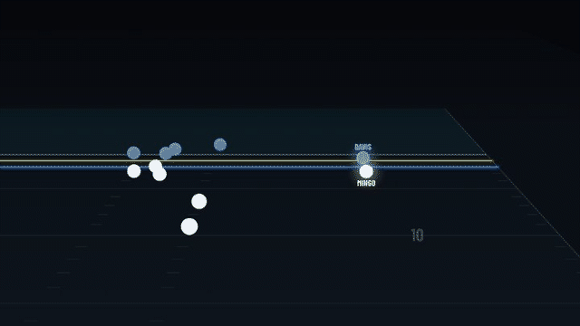

# keys

I am a big football fan, so when the NFL put its tracking data on Kaggle for the 2026 Big Data Bowl I had to build something with it. This is that something.

The NFL records every player ten times a second. The moment a quarterback lets the ball go, the receiver and the nearest defenders all break for the spot where it will land. I trained a model to predict those paths, from the throw until the ball arrives.

Then I turned the model into a rating. For every pass, it guesses where a defender should end up. Closing over expected is how much closer he actually got. It only measures what happens after the throw, and it says nothing about whether the pass was caught. Every number has to pass a set of checks before it is published, so a good scheme cannot pass for a good player.

The site is live at https://d2i4e06jgm34jr.cloudfront.net. It opens on a reel of the season's best plays, replayed from the real tracking data. There is a leaderboard you can filter any way you like, a page for every defender, and a what if tool that lets you move the landing spot and ask the model what it would expect instead.

## how it is built

Python, polars and PyTorch for the model. The pipeline runs on AWS: Fargate jobs behind Step Functions, the API on Lambda, the site on CloudFront, all of it in Terraform. GitHub Actions tests, builds and deploys on every push to main. The site is React and TypeScript. The replays are drawn on a canvas straight from the data, so there are no video files anywhere, and the players move exactly as the tracking has them.

The held out error is 0.57 yards on plays of forty frames or fewer. Assuming everyone keeps running in a straight line gives 1.61.

## running it

The tracking data is about 1.6 GB and is not in this repo. Download it from Kaggle and put the two folders in the project directory. Then `uv run pytest` runs the tests. For the website, put the site's address in site/.env.local as KEYS_DATA_ORIGIN, then `npm install` and `npm run dev` inside site.

There are no faces on the site. Every player gets a badge in his team's colors with his initials, because I have no right to use NFL headshots.
